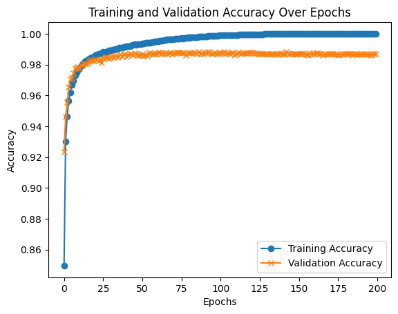
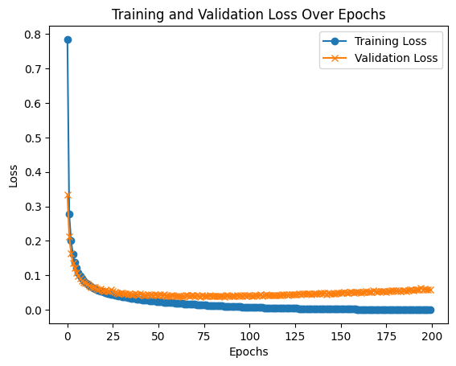
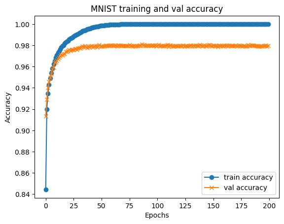
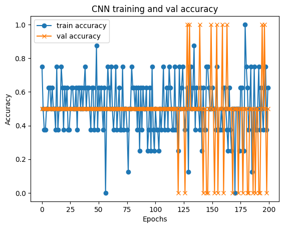

# CNN 층 동결(Layer Freezing) 실험

고등학교 때 신경망(NN → CNN)을 독학하면서 진행한 개인 실험입니다.
"합성곱 층을 동결하고 분류기만 학습하면 어떻게 되는가"를 MNIST와 직접 모은 이미지 데이터에서 확인했습니다.

- 언어/프레임워크: Python, TensorFlow(Keras), Matplotlib
- 실행 환경: Google Colab
- Claude AI는 github 정리요소로 사용, 코드 작성에는 미사용함.

```
src/
  frozen_layer_cnn.py           # 실험 1: 합성곱 층 동결 CNN (MNIST)
  mnist_mlp_and_custom_cnn.py   # 실험 2: MNIST MLP + 직접 모은 이미지로 CNN 학습
results/                        # 학습/검증 정확도·손실 그래프
```

## 실험 1 — 합성곱 층을 동결한 CNN (MNIST)

`src/frozen_layer_cnn.py`

- 구조: Conv(32) → MaxPool → Conv(64) → MaxPool → Flatten → Dense(128) → Dense(10)
- 마지막 Dense 2개 층만 학습하고, 합성곱·풀링 층은 `trainable = False`로 동결
- Adam(lr = 1e-4), batch 32, 200 epochs

| 정확도 | 손실 |
|---|---|
|  |  |

**결과:** 검증 정확도 약 98.7%에서 수렴했습니다. 학습 정확도는 100%에 도달해 후반부에는 과적합 경향이 보입니다.

## 실험 2 — MNIST MLP + 직접 모은 이미지 데이터로 CNN 학습

`src/mnist_mlp_and_custom_cnn.py`

1. **MNIST MLP:** Flatten → Dense(128) → Dense(10), 200 epochs
2. **직접 모은 이미지 데이터 CNN:** Google Drive 폴더의 이미지를 28×28 흑백으로 불러오고, 회전·이동·확대 데이터 증강을 적용.
   Conv 3층(+BatchNorm, MaxPool) → Dense(128) → Dropout(0.5) → 출력층 구조에서 마지막 3개 층을 제외하고 동결

| MNIST MLP 정확도 | 직접 모은 데이터 CNN 정확도 |
|---|---|
|  |  |

**결과**
- MNIST MLP: 검증 정확도 약 98%
- 직접 모은 데이터 CNN: 정확도가 0 / 0.5 / 1.0 사이를 오가며 **학습이 안정적으로 되지 않았습니다.**

## 돌아보며 — 한계와 배운 점

- **엄밀한 의미의 전이학습은 아니었습니다.** 두 코드 모두 사전학습된 가중치를 불러오지 않고, 새로 만든(무작위 초기화된) 모델의 층을 동결했습니다.
  실험 2에서도 MNIST 모델(MLP)과 CNN은 서로 다른 모델이라 가중치가 전달되지 않았습니다.
  그래서 실험 1은 "무작위 합성곱 특징 + 학습된 분류기"만으로도 MNIST에서 약 98.7%가 나온다는 결과로 해석하는 것이 정확합니다.
- **직접 모은 데이터가 너무 적었습니다.** 그래프의 정확도가 몇 개 값으로만 끊어지는 것으로 보아, 학습·검증 이미지가 매우 적었던 것으로 보입니다.
  동결된 무작위 특징으로는 적은 데이터를 일반화하기 어려웠습니다.
- **개선 방향:** MNIST로 CNN을 먼저 학습 → 가중치 저장 → 같은 합성곱 층을 불러와 동결 → 새 데이터에서 분류기만 미세조정(fine-tuning)하는 방식이 올바른 전이학습 절차입니다.
  데이터를 늘리고 Early Stopping으로 과적합도 줄일 수 있습니다.

## 실행 방법

```bash
pip install -r requirements.txt
python src/frozen_layer_cnn.py
```

`mnist_mlp_and_custom_cnn.py`는 Google Colab에서 Google Drive를 마운트해야 실행됩니다 (`/content/drive/MyDrive/VisionCNNdata`).
